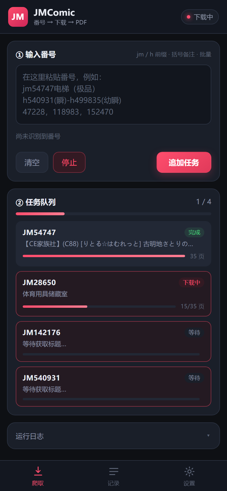
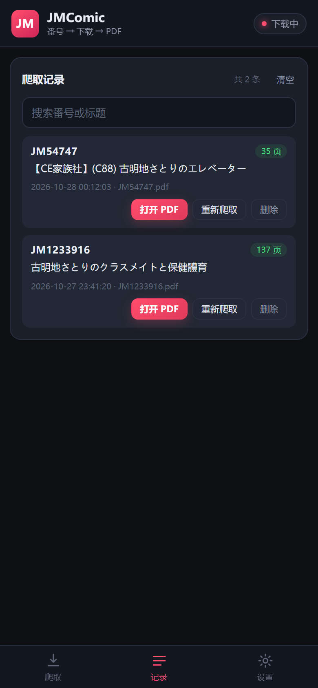
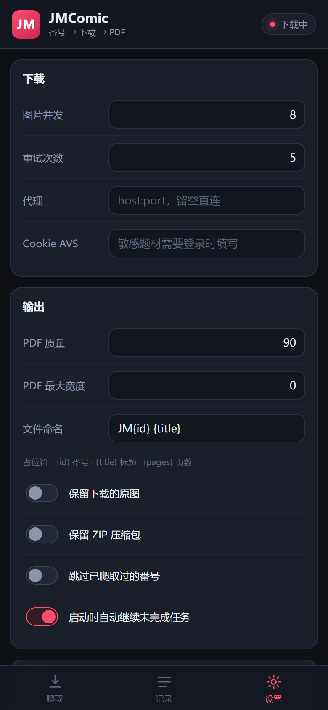

# JMComic 安卓版

桌面版 `jmcomic-client` 的安卓移植：输入番号 → 下载 → 还原图片 → 合成 PDF。
核心爬取逻辑用 Java 重写（不依赖 Python / Gradle），界面是 WebView + 原生桥接。

- **安装包**：`dist/JMComicClient.apk`（v1.0.1，约 60 KB，已签名，Android 10 及以上）
- **包名**：`com.jmcomic.app`

<p>
  
  
  
</p>

## 更新记录

### v1.0.1（修复图片错位）

- **问题**：部分 PDF 出现整页错位、画面被横向切断（像被撕成横条重新拼过）。
- **原因**：分块还原的切割数要用**不带扩展名**的文件名计算（官方库的 `img_file_name` 是 `00001`），
  之前误用了带后缀的 `00001.webp`。同样的图，正确 num=16，错误算法得 4，于是每一页都按错误的块数重排。
- **修复**：`Downloader` 计算 num 前先去掉扩展名，并加了回归用例。
- **验证**：JM1233916 三张样本与官方库解码逐张对比，平均差异 1.6~2.4（仅 JPEG 重编码噪声）；
  JM1187594 双章节 PDF 的第 1/39/76 页与官方解码对比，差异 1.0~2.7。
- **注意**：v1.0.0 生成的 PDF 是错的，需要用 v1.0.1 重新爬取（记录页「重新爬取」即可），
  旧文件可以手动删掉。

## 功能

- 番号输入与桌面版规则一致：`jm54747电梯（极品）`、`h540931(瞬)-h499835(幼瞬)`、
  `142176(母子大车)404477(...)`、`47228，118983`、18comic 链接、`aid=` 片段，重复自动去重。
- 批量队列，**运行中可以继续追加**（按钮会变成「追加任务」）。
- 队列持久化：关掉应用（甚至强杀）后重开，列表还在，未完成的自动继续。
- 前台服务：切到后台、息屏也能继续下载，通知栏显示进度。
- 每本输出一个 PDF，保存到系统 **「下载 / JMComic」** 目录，可在「记录」页直接打开。
- 记录页：搜索、打开 PDF、重新爬取、删除。
- 设置：图片并发、重试次数、代理、Cookie AVS、PDF 质量/最大宽度、文件命名、保留原图/ZIP、
  跳过已爬取、启动自动续跑。

## 安装

1. 把 `JMComicClient.apk` 传到手机（微信文件传输 / 数据线 / 网盘均可）。
2. 点击安装，按提示允许「安装未知来源应用」。
3. 首次启动会申请通知权限（用于显示下载进度），可拒绝，不影响下载。

> 自签名安装包，未上架应用商店。若系统提示风险，选择「仍要安装」。

## 与桌面版的差异

| 项目 | 桌面版 | 安卓版 |
| --- | --- | --- |
| 客户端实现 | api / html 可切换 | 仅 api（html 端有 Cloudflare 风控，移动端不适用） |
| 存储位置 | 可自定义任意目录 | PDF 固定在系统下载目录；临时文件在应用私有目录（分区存储限制） |
| ZIP / 解包 | ZIP → 解包 → PDF | 直接由图片合成 PDF；开启「保留 ZIP」时才额外打包 |
| 配置/历史 | `config/*.json` | 应用私有目录 `files/settings.json`、`history.json`、`queue.json` |

## 设置说明

| 设置 | 说明 |
| --- | --- |
| 图片并发 | 1~8，默认 8；越高越快，内存占用也越高 |
| 重试次数 | 接口/图片失败重试轮数，默认 5 |
| 代理 | `host:port`，例如 `127.0.0.1:7890`；留空直连 |
| Cookie AVS | 少数需要登录的题材，填浏览器里名为 `AVS` 的 Cookie |
| PDF 质量 | 50~100，默认 90 |
| PDF 最大宽度 | 0 表示原始尺寸；设置后按比例缩小，可显著减小体积 |
| 文件命名 | 默认 `JM{id} {title}`，支持 `{id}` `{title}` `{pages}` |
| 保留原图 / ZIP | 默认关闭，下载完自动清理临时文件 |
| 跳过已爬取 | 默认关闭；开启后命中历史直接跳过 |
| 启动自动继续 | 默认开启 |

## 从源码构建

需要：JDK 17、Android SDK（build-tools 35、platform 35）。

```bat
build.bat
```

或：

```bat
python build.py
```

脚本会依次执行 `aapt2 compile → aapt2 link → javac → d8 → zipalign → apksigner`，
产物在 `dist/JMComicClient.apk`。不依赖 Gradle，也不需要联网下载依赖。

签名用的 keystore 在 `keystore/jmcomic.jks`（口令 `jmcomic123`），仅用于本地安装；
如果要发布，请换成你自己的签名。

## 目录结构

```
app/
  AndroidManifest.xml
  assets/            界面（index.html / style.css / app.js）
  res/               图标、主题
  src/com/jmcomic/app/
    MainActivity.java   WebView 容器 + 状态推送
    Bridge.java         JS ↔ Java 接口
    Engine.java         队列、持久化、下载线程、历史
    DownloadService.java 前台服务（保活 + 通知）
    Downloader.java     单本流程：详情 → 并发下载 → 还原 → PDF
    JmApi.java          禁漫 API（token/AES 解密/图片域名）
    JmImage.java        图片分块还原算法
    JmParser.java       番号解析
    PdfWriter.java      轻量 PDF（JPEG 直嵌）
    AndroidCodec.java   Bitmap 解码/还原/转 JPEG
    Settings.java / Json.java
desktop/             桌面 JVM 验证程序（不打包进 APK）
build.py             手工打包脚本
```

## 验证情况

- **协议与核心逻辑**：在桌面 JVM 上跑通真实下载。
  - JM54747：35 页，PDF 4.7 MB，15 秒（含测试用的 WebP 转码开销）。
  - JM1187594（双章节）：76 页，PDF 11.4 MB，章节顺序正确。
  - 生成的 PDF 用 pypdf 校验：页数、页面尺寸、标题元数据均正确。
- **图片还原算法**：与官方 Python 库逐像素对比，差异 0.0。
- **界面**：用 Chromium 以 390×844 手机视口渲染检查，三个页面布局正常。
- **APK**：aapt2 校验包名/权限/minSdk/targetSdk，apksigner 签名校验通过。

> 说明：本机没有安卓模拟器镜像，未做真机安装测试。核心下载与 PDF 生成已在 JVM 上验证，
> 界面已在 Chromium 上验证；Android 专属部分（前台服务、MediaStore、WebView 桥接）按标准 API 编写，
> 如真机遇到问题，把 `adb logcat | grep Jm` 的日志发我即可定位。

## 免责声明

本项目仅为开源库 `jmcomic` 的客户端实现，不提供、不托管任何内容。
请遵守当地法律法规与目标站点服务条款，仅下载你有权访问的内容。
